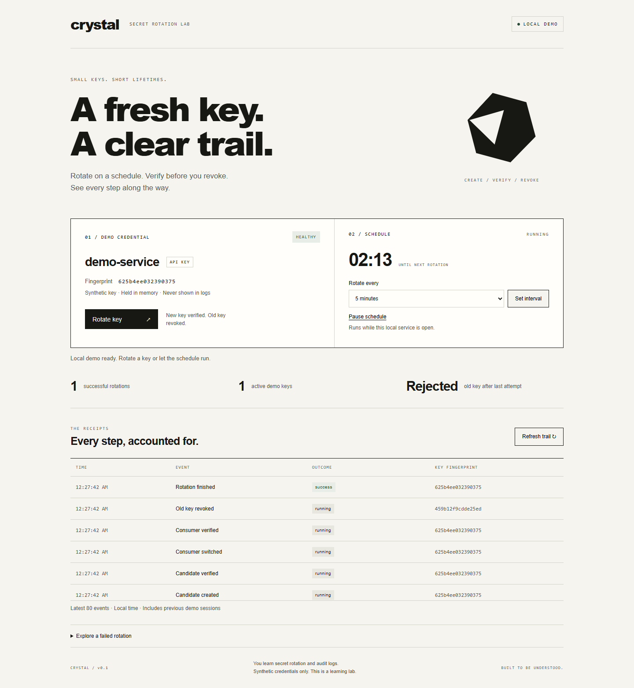

# Crystal

**Rotate synthetic API keys on a schedule, verify the replacement, and inspect every step.**

Crystal is a local cybersecurity learning lab. It demonstrates the part of credential rotation that matters most: preserve the working key until the new key and its consumer have been verified. Its cream-and-black dashboard follows the visual direction in the supplied reference card.



## Run

Requires Python 3.11 or newer and a modern browser. Verified here with Python 3.13.7 on Windows. There are no third-party runtime dependencies and no cloud account is needed.

From the `crystal` project directory:

```powershell
python -m crystal serve
```

Open **http://127.0.0.1:8765**. The default foreground schedule rotates every five minutes. Ctrl+C stops the service and schedule. Use the numeric loopback address; `localhost` is intentionally rejected by the Host check.

For a faster demo:

```powershell
python -m crystal serve --interval 10
```

Options: `--port 8766`, `--interval 10` through `86400`, `--paused`, and `--data-dir PATH`. Only `127.0.0.1` binding is supported. One process may own a data directory at a time. Metadata defaults to the ignored `.runtime/` folder.

## Try the learning flow

1. Press **Rotate key**. The fingerprint changes, the successful rotation count increases, and the old-key result becomes **Rejected**.
2. Set the interval to ten seconds and resume the schedule. Watch the countdown and audit trail, then pause it.
3. Expand **Explore a failed rotation**, choose a candidate or consumer verification failure, and rotate. The working key remains accepted and the failed candidate is removed.
4. Choose an old-key or candidate cleanup failure. The dashboard reports **Cleanup required**, exposes two active demo keys, and blocks further rotation. Restart the disposable demo to begin a fresh session.

The failure choice applies to the next manual rotation only. Scheduled rotations use the normal successful demo flow. Counters describe the current session; the audit trail also includes previous sessions.

## CLI

Keep the service running in one terminal and use another terminal in this directory:

```powershell
python -m crystal status
python -m crystal rotate
python -m crystal audit
python -m crystal schedule --interval 60
python -m crystal schedule --interval 60 --paused
python -m crystal rotate --failure consumer_check
```

Use the service's `--port` with each client command when changing ports. `rotate --request-id UUID` makes an explicit retry read the earlier attempt instead of creating another key. Rotation commands return a nonzero exit code for failed verification or cleanup. Client requests ignore system proxies and reject redirects.

## Architecture

```text
Dashboard / CLI → loopback HTTP boundary → rotation controller
                                            ├─ synthetic provider
                                            ├─ demo consumer
                                            └─ SQLite metadata and audit events
Foreground scheduler ────────────────────────┘
```

`crystal/core.py` contains the staged controller, in-memory provider/consumer, scheduler and runtime ownership lock. `crystal/server.py` exposes fixed HTTP routes. `crystal/__main__.py` provides server/client commands; `crystal/static/` contains the dashboard.

Each attempt proceeds through create → candidate verification → consumer switch → consumer verification → old-key revocation. Unique attempt IDs make retries idempotent, while a lock prevents different attempts from overlapping. A missed interval triggers one due rotation rather than a backlog. Manual attempts reset the countdown. Scheduling settings are session configuration and reset on restart.

The provider models authentication in memory. Rotation checks use the same provider directly; the tests additionally call the real `/api/demo` HTTP endpoint to prove old-key rejection and new-key acceptance. Raw keys are never returned by a public endpoint. This is not an external API-provider integration.

## Security model and limits

- Credentials are randomly generated, synthetic and held in memory. The provider stores full SHA-256 digests; audit fingerprints are shortened identifiers, not authentication values.
- SQLite stores allowlisted events, IDs, timestamps, phases and fingerprints. It is **not a production vault or tamper-proof audit log**. Logs grow until the owner removes or archives the disposable runtime while the service is stopped; the UI displays the latest 80 events.
- Full restart creates new credentials and marks unfinished attempts interrupted. It does not recover production secrets or resume a partially completed external rotation.
- Exact Host/Origin checks, a per-process session token, a custom session-request header, no CORS access, strict bounded JSON bodies and a content security policy protect the browser boundary.
- Local users/processes can obtain the demo session token. It prevents hostile cross-origin browser mutations; it is not user authentication or protection against compromise of the machine.
- The standard-library HTTP server is for this local lab. No real provider, real credential import, public hosting, OS service installation or production deployment is supported.

See [SECURITY.md](SECURITY.md) and [verification/REVIEW.md](verification/REVIEW.md). Authentication and request-boundary decisions are flagged for Jake's manual review before any future production integration or publication.

## Verification

```powershell
python tools/check.py
# If Bandit is already installed:
python tools/check.py --bandit
```

The reusable checker writes `verification/tests.txt` and `verification/checks.json`, plus `verification/bandit.json` when selected. It does not install dependencies or make external requests. Tests create disposable stores below `.runtime/tests/` and loopback servers on ephemeral ports. Some execution sandboxes require permission for loopback access.

Verified October 5, 2026: 23 unit/integration tests passed, application-source Bandit scan passed with no findings, and JavaScript syntax checked. Browser observations are recorded separately in [verification/BROWSER.md](verification/BROWSER.md), with desktop/mobile screenshots. These checks are evidence for this demo, not a security certification.

For the already-installed Playwright CLI, an optional repeatable browser check is available:

```powershell
playwright-cli -s=crystal open http://127.0.0.1:8765
playwright-cli -s=crystal run-code --filename=tools/browser-smoke.js
```

Use a disposable session. This check exercises real UI actions and scheduling, saves screenshots, and deliberately ends in cleanup-required state; restart the demo afterward. It assumes a fresh healthy session and the default port. Playwright is a development-only verification tool, not a runtime requirement.

## Learning and attribution

[LEARNING.md](LEARNING.md) explains the concepts, [DECISIONS.md](DECISIONS.md) records tradeoffs, and [STATE.md](STATE.md) records scope and current verification.

Research references accessed October 5, 2026:

- [AWS rotation phases](https://docs.aws.amazon.com/secretsmanager/latest/userguide/rotate-secrets_lambda-functions.html): staged verification and finalization concepts.
- [CZI Rotator](https://github.com/chanzuckerberg/rotator): source/sink concept; archived upstream, not adopted. Detailed source/CI retrieval was unsuccessful during research.
- [Truffle Security how-to-rotate](https://github.com/trufflesecurity/how-to-rotate): reference for future provider-specific research.

No upstream implementation code was copied. The visual direction came from Jake's supplied image; the local SVG was drawn for this demo. Codex assisted implementation, tests, review and documentation; local Ollama provided a bounded styling draft that was reviewed. Raw worker evidence remains separately in the private planning records. No free remote model or paid API was used for drafting.

Original project code is provided under the [MIT license](LICENSE). No remote GitHub repository has been created or published. GitHub CodeQL/Bandit workflows and repository protections remain a future repository-publication stage under Jake's baseline.

## Publication status

See [publication review](PUBLICATION.md) for the October 5 source snapshot, fresh local checks, evidence boundaries and current hosted-check distinction.
